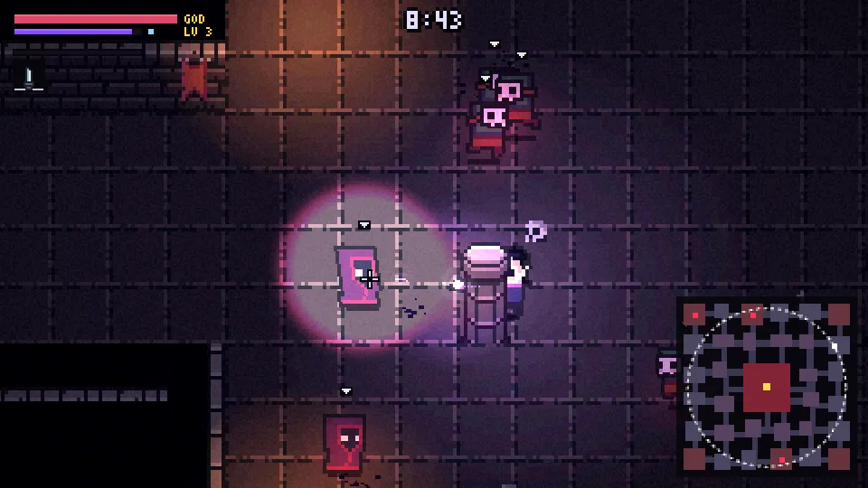
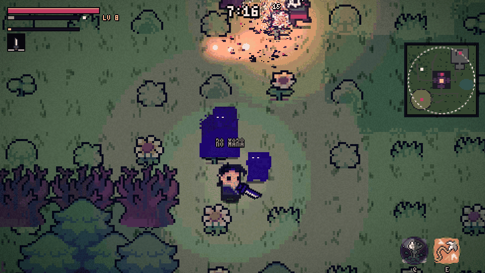
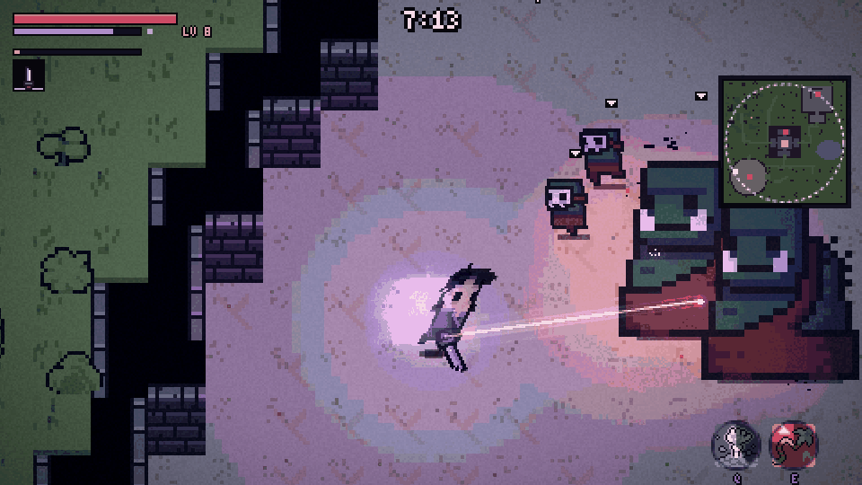
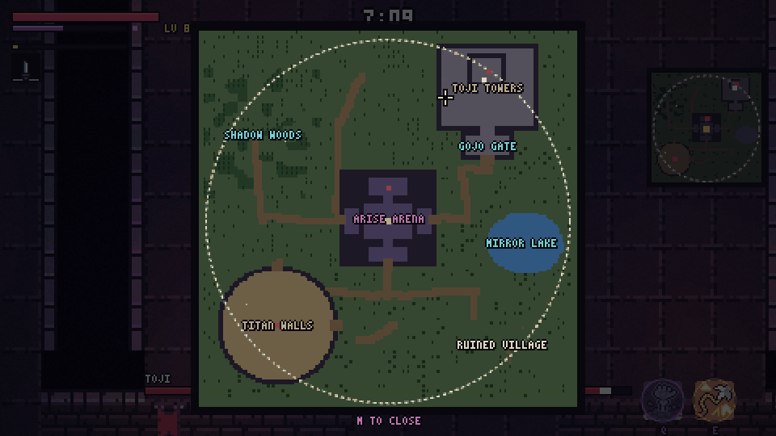
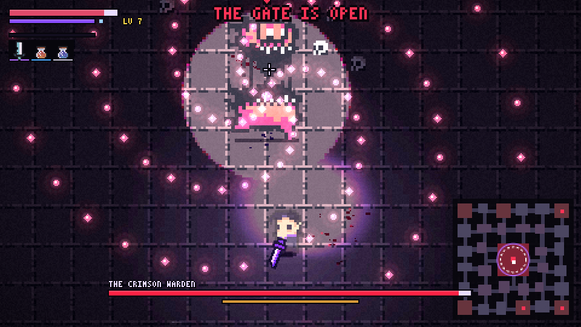
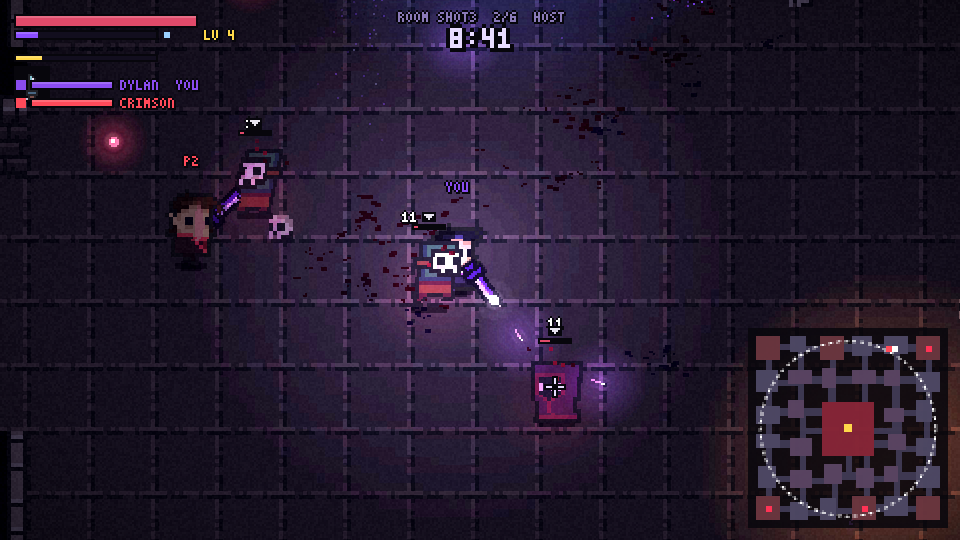

# Shadow Gate

A top-down pixel-art action game for phone and desktop: a Solo Leveling style hunter clearing a gate, with
Sekiro parries, Elden Ring rolls and bullet-hell bosses, structured like one Nightreign night. Static site, no backend.

**Play:** https://game.dylanlu.com/



| Shadow Woods: summoned shadows fight beside you | Titan Walls: hook to the nape | The map: named places, the storm circle |
|---|---|---|
|  |  |  |
| **The Crimson Warden, phase 2** | **Co-op: up to 12, no server** | |
|  |  | |

## Modes

You start on the main menu: pick a color and a name, then **PLAY SOLO**, **HOST** or **JOIN**.

- **PvE**: the night below, alone or with up to 11 friends.
- **Battle royale**: solo, duos, trios or squads (up to 12 players). Same map, camps and area bosses for loot
  and XP, but player shots hit other teams (never your own), the storm closes to nothing, and there's no coming
  back: the dead spectate a teammate. Last team standing wins. Parry an enemy player's shot and it flies back at them.

Hosting makes a lobby with a room code and an invite link. Make it **PUBLIC** and it shows up in everyone's
**JOIN** list. The host picks the mode and team size, can tap a player to move them to another team, and presses
**START**. After a match, **PLAY AGAIN** brings everyone back to the lobby.

## A night

About 10 minutes on one big fixed outdoor map (the same layout every run), Fortnite-style named places:

| Place | What's there | Beat its boss for |
|---|---|---|
| **Arise Arena** | the old dungeon at the center; the Shadow Knight waits in its north hall | **Shadow Summon**: raise two shadow soldiers (mana) |
| **Gojo Gate** → **Toji Towers** | a walled courtyard that opens into the fortress; Toji holds the inner keep | **Boundless**: unlimited mana |
| **Titan Walls** | a ring wall in the south-west with titan camps; the Armored Titan guards it | **Grappling Hook**: zip to walls, trees and foes |
| Shadow Woods, Mirror Lake, Ruined Village, the fields | camps, chests, roads | gear and flasks |

1. Drop in somewhere on the rim.
2. Clear camps and the named places to level up and find gear. Cleared camps leave a chest. Loot is sparse and
   stands in a beam of its rarity color. Area bosses guard their ground and walk home if you run.
   In co-op, a boss's unique reward goes to every player, wherever they are.
3. The shadow storm closes in stages toward Arise Arena; standing in it hurts more as the night goes on.
4. At 9:00 the gate opens: anyone outside is pulled in and the Crimson Warden rises. Kill it to clear the night.

Enemy levels are hidden. The marker over an enemy says how bad it is for you: white is a fair fight, red is well
above you, a purple skull means you will die. Solo gets one revival per night; in co-op you come back beside a teammate. Refreshing the page resumes the night
where you were (saved in the browser); a co-op client gets their hunter back and rejoins the host's night.

### Items

Active items fill two slots and cost mana. Desktop: `Q` / `E` (aimed at the cursor). Phone: two thumb buttons at the
bottom right; tap to use (aims at the nearest foe), or drag off the button to aim and release to fire.
The grappling hook pulls you to whatever it bites; reaching a foe ends in a spinning cut, and on a titan it's a
nape strike for triple damage that ignores armor. Relics like Boundless are passive.

### Weapons and abilities

Attack is the same input for every weapon (hold left click / hold a finger on the right side); each type reads it its own way.

| Type | Weapons | How it plays |
|---|---|---|
| Thrown | Shadow Dagger, Twin Fangs, Scatterfang, Monarch's Edge, Stormneedle | the dagger stream; costs mana |
| Katana | Kusabimaru, Yoru | three-slash combo with a lunge on the third; slashes cut enemy bullets out of the air |
| Fists | Divergent Fist, Kokusen | jab, cross, jab, uppercut. Press again just as the last punch lands (the fist crackles red) or right after a perfect parry: **Black Flash**, 2.5x |
| Greatbow | Hunter's Greatbow, Skypiercer | hold to draw (aim line, you walk), release to loose; a full draw glints and pierces; a tap is a quick weak shot |
| Thunder Spear | Thunder Spear | 3 charges, one back every 7s; sticks into a foe or wall and blows 0.6s later, triple damage to titans |
| Inverted Spear | Inverted Spear | long thrust that ignores armor and unmakes bullets on its line |
| Chain whip | Thousand-Mile Chain, Kusarigama | wide sweep; the tip drags light foes in |

Melee is free; perfect-parry charges empower it too. Abilities: **Domain Expansion** (fills from perfect parries and kills,
shown on its button: everything inside nearly stops, their bullets come apart, your hits crit), **Ruler's Authority**
(tap: shove and stagger a cone, bullets fly home; hold Q/E or drag the button: pull), **Shadow Exchange** (swap with your
farthest shadow, else blink), **Stealth** (4s unseen; the first hit out of it is a 3x crit). Relics: **Mikiri Counter**
(roll into a thrust or heavy swing to counter it) and **Beru** (a permanent shadow that respawns 20s after it falls).

## Run

```bash
npm install
npm run dev        # prints a Network URL you can open on your phone (same Wi-Fi)
npm run build      # static output in dist/
```

Every push to `main` deploys to GitHub Pages (`.github/workflows/pages.yml`): https://game.dylanlu.com/

## Controls

| | Phone | Desktop |
|---|---|---|
| Move | drag anywhere on the left side | WASD |
| Parry | release that thumb | right click (or K) |
| Shoot | tap or hold anywhere else | left click toward the cursor |
| Roll | flick with a second finger | Space / Shift |
| Items | tap or drag the two item buttons | Q / E |
| Map | tap the minimap | M |
| Menu / pause | II button (top left) | Esc / P |

Perfect parry (first 0.15s): staggers normal enemies with a counter-strike, reflects bullets, refills mana and
charges empowered shots. Enemies killed by a counter-strike rise as shadow soldiers. Every attack can be
parried. A white glint is a normal attack; a red glint is heavy: perfect-parry it for a bigger payoff (a late guard
chips hard), or roll through it. Parrying the boss fills its posture bar; a full bar breaks it open.

Solo pauses behind the menu; with others the match keeps going. Dev shortcuts (spawn near you): `1` ghouls,
`2` casters, `3` brute, `4` boss, `5` wave, `0` clear, `G` god mode, `H` hitboxes.

## Multiplayer (up to 12, no server)

Peers find each other through public Nostr relays via [Trystero](https://github.com/dmotz/trystero), then all
traffic is direct WebRTC, so it works from GitHub Pages with no backend. An invite link (`…/#room=CODE`) drops
you straight into that lobby.

- The earliest joiner hosts: the lobby settings, enemies, the boss and enemy bullets run there; enemies stream out at 15 Hz.
- Everyone simulates their own character, so movement and parry timing never wait on the network. Attacks on a
  remote player are resolved on that player's machine, with a little lag compensation on the parry window. In
  battle royale that includes other players' shots (each machine checks enemy shots against its own hunter) and
  melee strikes (`Game.strikePlayers`).
- If the host leaves, the next player in line takes over the enemies and the lobby.
- Public lobby list: hosts of public lobbies join one well-known Trystero room (`lobbies`) and broadcast a small
  ad every 2 s; the JOIN screen listens there and drops lobbies not heard from for 10 s.
- Test locally with two players in one page: `npm run dev`, then open `/dev/coop.html` (add `?mode=pve` or
  `?mode=br` to have the host start as soon as the second player is in).

## Code map

- `dev/rig.html`: hero frame viewer (`npm run dev`, then open `/dev/rig.html`)
- `src/game/assets.ts`: the hero is 0x72's elf recolored and hand-edited into Dylan (`dylanize`), plus a shadow dagger

- `src/engine/renderer.ts`: low-res Canvas2D layers (scene, light, glow, ui) composited by a WebGL2 post shader
  (banded lighting, bloom, chromatic aberration, flashes, vignette, grain)
- `src/engine/input.ts`: touch gestures and mouse/keyboard, both mapped to the same actions
- `src/engine/audio.ts`: sample-based mixer (layered events, pitch variation, panning, reverb, muffle, music crossfades)
- `src/game/game.ts`: loop, combat resolution (`hitPlayer`), progression, juice (hitstop, shake, slow-mo), rendering
- `src/game/world.ts`: the fixed outdoor map (terrain, named places, roads, props, autotiled walls, chunked drawing, minimap)
- `src/game/night.ts`: the night's clock, storm, camps, mini-bosses, chests, the gate; `src/game/items.ts`: loot tables
- `src/game/bosses.ts`: the area bosses (Shadow Knight, Toji, Armored Titan) and titans; `boss.ts`: the Crimson Warden
- `src/game/player.ts` (incl. the grappling hook), `enemies.ts`, `fx.ts`, `hud.ts` (item buttons, full map)
- `src/game/weapons.ts`: weapon types, abilities and relics; every melee / blast hit goes through `Game.playerStrike`
- `src/ui/menu.ts`: main menu, join list, lobby, pause and end screens (DOM, drawn in the game's pixel font)
- `src/net/net.ts`: Trystero room, join order, host election; `src/net/coop.ts`: what's synced and how;
  `src/net/lobby.ts`: lobby settings, team balancing, public lobby discovery

## Credits

- Dungeon tiles, monsters and the hero base: [0x72 DungeonTileset II](https://0x72.itch.io/dungeontileset-ii), CC0
- Overworld tiles, trees, towers, samurai and item icons: [Ninja Adventure](https://pixel-boy.itch.io/ninja-adventure-asset-pack) by Pixel-boy and AAA, CC0
- Audio: Kenney, OpenGameArt and Ninja Adventure (jingles) CC0 packs, see [public/assets/audio/CREDITS.md](public/assets/audio/CREDITS.md). Rebuild with `tools/audio/fetch.sh` then `tools/audio/build.py`
- Hero: 0x72's elf, recolored and hand-edited into Dylan with six co-op color variants (`dylanize` in `src/game/assets.ts`)
